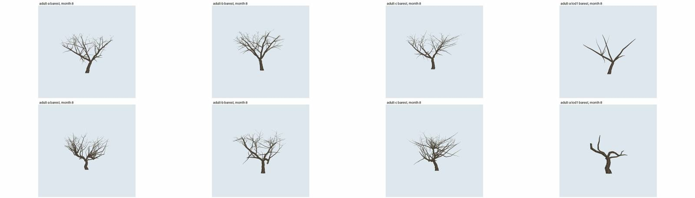
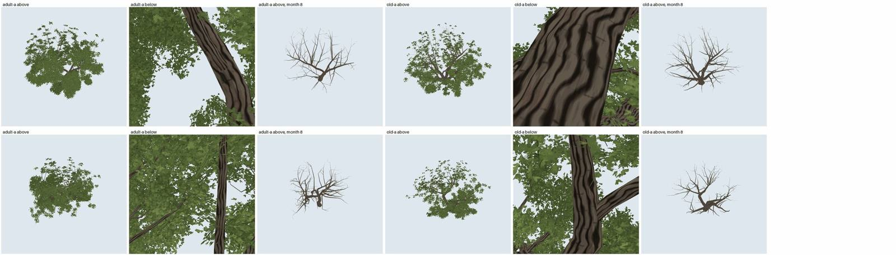
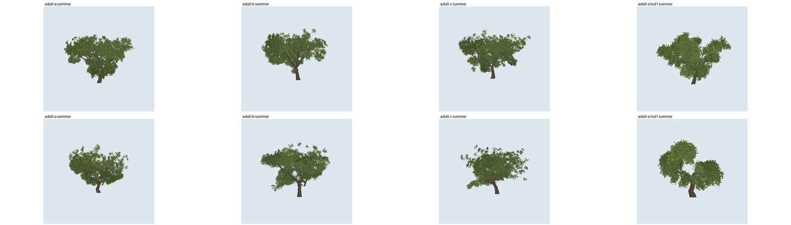

# Generator and site, round 2: what the algarrobo negro taught

Asked by marcos on 2026-11-25, after Antigravity added `neltuma-nigra` from scratch and
listed what got in its way. Everything here is in one PR. **No merged look draws
differently**: every new form parameter is optional, its default draws as before, and a
new test (`test_merged_looks_still_build_the_same_models`) rebuilds every merged model in
plain Python and compares it with `tests/fixtures/plant_fingerprints.json`. So the
generator stays `plant@1`, as spec §4 and §7 ask.

## Generator (`tools/blender/plant/`)

- **Sympodial crookedness** (`trunk.kinks`, `trunk.kink_angle_deg`, `trunk.light_bias`,
  `branching[].kinks`). With `kinks` above 0 a branch grows in runs of uneven length and,
  at up to four breaks, its course itself turns 40–90° in any direction. The turn is kept
  (the old slow bends swing back to a straight average line; these add up), then leans
  partly back towards the light: up, out from the crown's axis and the way the branch
  set out. That keeps limbs inside the crown instead of folding back over the trunk.
  The bole breaks at half the rate, level 1 limbs at 80 % and finer wood at 60 %, unless a
  level sets its own. `kinks` varies between variants, like the other crookedness traits.
- **Knots** (`trunk.knots`): the wood swells by up to a third where it breaks and where a
  branch leaves its parent, instead of tapering smoothly.
- **Segments where the wood turns**: broken branches get more runs (twigs too), and the
  coarser drawings (thin wood, carriers, lod1) always keep the break points, so a fine
  twig doesn't turn back into a straight stick.
- **Below the ground (bug)**: a limb sagging part way (`0 < old.limb_sag < 0.8`) had no
  crown to stop it and no ground to rest on, so it drooped into the soil. It now stops at
  the ground. No merged look used those values: algarrobo blanco has 1.0, negro 0.0.
- **Beaded pods** (`fruit.form: pod_beaded`, `fruit.beads`, `fruit.constriction`): the
  pod narrows between seeds, with a ring at every bead and every pinch.
- **Two-colour fruit** (`fruit.accent`: `spots`, `streaks`, `tip`, `blush`): the
  palette's `fruit.accent` is painted into a small fruit texture that the flat lit colour
  multiplies (lit × texture = accent, worked out in linear light). Round fruit gets UVs
  for it. `validate` fails if the look asks for an accent and the palette has none.
- **Clumps moved onto their wood** (`foliage.carry_share`, default 0.3 as before). I
  measured it on both algarrobos: the twigs that carry every clump would cost about
  6,700 triangles, and the adult's carriers get about 2,500 of the 20,000. Raising the share
  helps little (negro adult: 0.3 → 426 moved, 0.45 → 417, 0.6 → 331), because those
  triangles come out of the thicker bark, which then loses its thinner limbs (they become
  6 mm twigs). The real lever is the budget: a larger lod0 adult/old triangle budget,
  or giving the fruit less than its 10 %. Both are marcos's call (`budgets.json`), so I
  left them as they are.

### Before and after

The algarrobo negro as merged (top row of each picture) and the same look with
`trunk.kinks: [0.45, 0.7]`, `trunk.knots: 0.5`, `fruit.accent: spots` (bottom row). This
is a trial look outside the repository: the merged look is frozen, and a new look version
is marcos's call.

Barest month (August), adult variants and lod1:



From above (in leaf, then bare) and from below, adult and old:



Summer:



## Contact sheet and reference tools

- `sheet.png` now has the adult variants in the **barest month of the leaf calendar**
  instead of the middle of leaf fall (the middle of the longest run with no leaf tone,
  else of months with only dry leaves), and a new row with the adult and the old tree
  **from above** (in leaf and bare) and **from below**.
- `uv run genes refs grid <id> <number or rNN> [--box l,t,r,b]` writes the photo with a
  0–1 grid (lines every 0.05) to `.work/<id>/box-<photo>.jpg`, and draws a box in yellow
  to check it.

## Sheet schema

- New optional `climate.habitat_min_c` and `climate.habitat_max_c`: the temperature
  extremes of the places the species grows (FAO/Galera's −10 to 48 °C kind of fact). They
  are not lethal limits; those stay in `frost_kill_c_*` and `heat_limit_c`. The page's
  thermometer shows the killing frost, or else the coldest where it grows, or nothing.
- **Open: facts with one end only** ("still growing at 95 years", "fruits at 7 years in
  cultivation"). Spec §5.1 says pietri.dev turns `min`–`max` into its own distribution,
  so a range without both ends changes the contract with the simulator. I asked marcos
  to choose: an explicit `at_least` / `at_most` shape (recommended), optional `min`/`max`,
  or leave such facts out for now. Nothing changed until he answers.

## Site

- The sitemap test counts the species it finds instead of expecting one.
- Every fixed schema value the page shows (growth forms, leaf types, leaf tones,
  triggers, fruit kinds, what it gives, levels, photo tags) and the usual guilds in
  `gives[].to` have their Spanish in `UI_ES`, and a test reads the schemas to keep it so.
  Adding a species no longer needs a Python change for those words.
- "People and the algarrobo" is now "People and this species" ("La gente y esta especie");
  the life text says "One tree grown alone by". The fruit ring and legend say "Pods" only
  for pods, "Fruit" otherwise.
- Spanish contracts "a el" into "al" ("Ramoneo al ganado").
- The Water and cold module shows the thermometer only when there is a fact for it.
- Triggers read whole ("después de la primera helada"), not "después de la" + any word.

## Try it

```
uv sync --group blender
uv run pytest
uv run genes refs grid neltuma-nigra r01 --box 0.1,0.1,0.9,0.95
uv run genes contact-sheet neltuma-nigra --out /tmp/nigra-sheet.png
uv run genes serve
```

To try the new parameters on a copy without touching a merged look: copy
`species/plants/neltuma-nigra/` to a scratch folder, add `"kinks": [0.45, 0.7], "knots": 0.5`
to `form.trunk` in its `look.json`, then
`uv run python tools/blender/plant/main.py <copy>/looks/1 --raw`.
